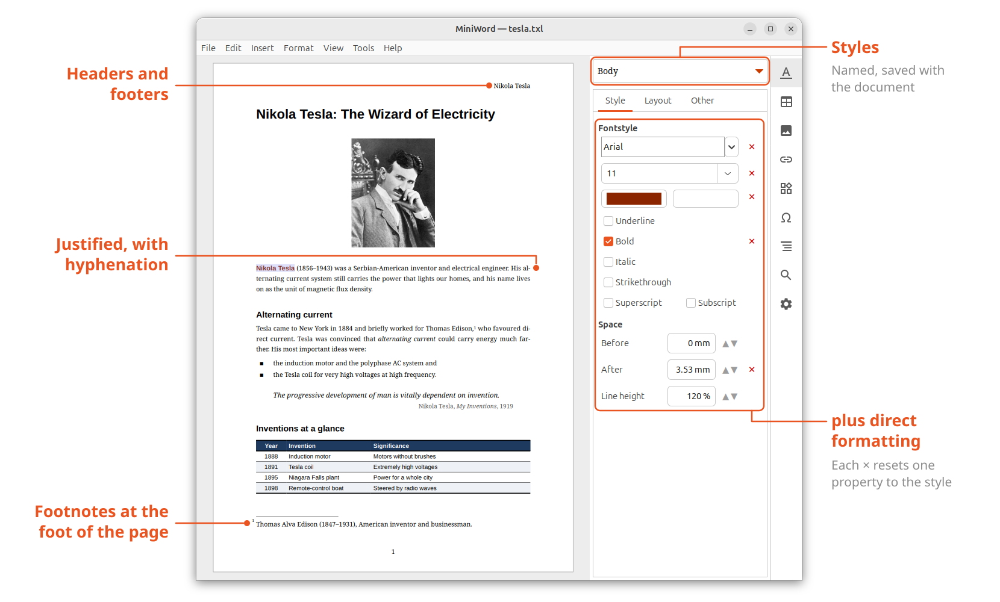

# MiniWord

**Between word processor and Markdown.**

A small desktop word processor with page layout and a readable plain text file format. Opens and saves Markdown, extensible in Python.

**[⬇ Download for Windows, macOS and Linux](https://github.com/chrisecker/miniword/releases)**

<!-- hero.png is exported from screenshots/hero/hero.svg (Inkscape) -->

## Features

- **Page layout:** headers and footers, footnotes, tables, images, hyphenation.
- **Readable file format:** plain text, so documents work with git and diff.
- **Markdown:** opens and saves Markdown files.
- **PDF export:** with selectable text and embedded fonts.
- **Desktop application:** runs locally, no account needed.
- **Plugins:** written in Python, for menu commands and import, export and paste filters.

## Status

MiniWord is young but already usable. Please keep backups of important documents. Found a bug or missing something? [Open an issue](https://github.com/chrisecker/miniword/issues).

## Install

Download the installer for Windows (`.exe`), macOS (`.dmg`) or Linux (`.deb`, `.rpm`) from the [Releases page](https://github.com/chrisecker/miniword/releases). On Linux, MiniWord can also be installed with pip. Details and other systems: see [INSTALL.md](https://github.com/chrisecker/miniword/blob/main/INSTALL.md).

## Documentation

- [Command line](https://github.com/chrisecker/miniword/blob/main/docs/commandline.md): convert documents without a window, e.g. `miniword report.md -o report.pdf`
- [Plugins](https://github.com/chrisecker/miniword/blob/main/docs/plugins.md): install Python plugins, with examples
- [File format](https://github.com/chrisecker/miniword/blob/main/docs/txl_format.md): the `.txl` format
- [Hacking](https://github.com/chrisecker/miniword/blob/main/docs/hacking.md): run the tests and demos

## License

This project is licensed under the GNU Lesser General Public License v3.0 or later - see LICENSE (LGPL) and COPYING (GPL, which the LGPL builds on) for details. Contact me if you need something else.

The bundled hyphenation patterns (`miniword/hyphenation/patterns/`) come from the hyph-utf8 package and have their own permissive licences - see `miniword/hyphenation/patterns/LICENSES.md`.
