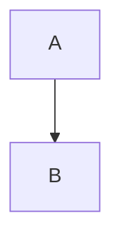

---
tags:
  - project
  - writing
aliases: [Typesetting note, TS]
created: 2026-11-16
---

# Typesetting note

Related: [[Book draft]], [[Book draft|the draft]] and [[Book draft#Chapter 2]].
Tags inline: #idea #project/miniword

![[diagram.png]]

![[Meeting notes#Decisions]]

> [!tip] Remember
> Callouts can have a title.

> [!faq]- Folded callout
> Hidden until opened.

This is ==highlighted== text. %%This is a hidden comment.%%

A paragraph with a block id. ^para1

- [ ] Open task
- [x] Done task

$$
a^2 + b^2 = c^2
$$

